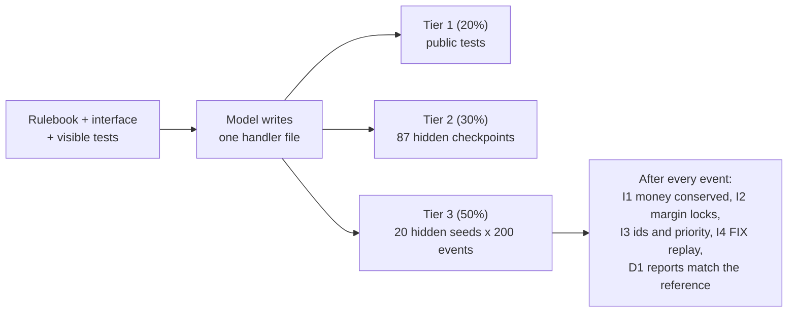

<div align="center">

# OrderBook-DST

**Can a model write exchange-core code that stays correct over hundreds of events, not just on the tests it can see?**

     

**[Video walkthrough](https://youtu.be/kGFsc9mu4KM)** · [Results](#results) · [How it is graded](#how-it-is-graded) · [Failure analysis](#failure-analysis) · [Run it](#run-it)

</div>

## In one paragraph

OrderBook-DST is an eval for a skill that matters wherever software moves money: implementing a stateful financial component *exactly* to a written spec. A model writes one file of a working exchange engine (fees, cancel/replace, FIX sessions, liquidation, atomic baskets, matching, funding, bankruptcy) from a rulebook and visible tests. The grader then replays 20 hidden, seeded, 200-event simulations against a reference engine and checks conservation invariants after every event. **Key finding:** the visible tests overstate quality for weaker models, and the hidden simulations catch bugs that a careful read-through of the code misses. The strongest models pass nearly everything, so the benchmark separates small and mid models, not the top.

| | |
|---|---|
| **Domain** | Electronic exchange matching, clearing and risk engines: fixed-point money, price-time priority, margin, liquidation, FIX sequencing |
| **Gap it measures** | Plausible code that passes its tests but silently breaks a conservation law or leaves a side effect out of a code path |
| **Size** | 17 tasks in 9 families, 87 hidden checkpoints, 20 hidden seeds x 200 events per task, 81 hand-written bugs the grader must catch |
| **Evidence** | 7 models, 329 real trials, a 30-trial feedback experiment, a blinded audit of the grader, a Claude Sonnet reference run |
| **Cost to reproduce** | $0 on free tiers (about a day per model because of daily request caps); grading needs no API key |

## Why it matters

Exchanges, clearing houses, brokers and crypto venues run matching and risk engines whose bugs move real money instantly. The tasks model failure classes that have caused real losses:

- **Side effects left out of a code path.** Knight Capital (2012): a deployment left old code reachable through a repurposed flag, and in about 45 minutes the firm lost roughly $440M.
- **Accounting that does not conserve money.** FTX/Alameda (2022): an account exempt from normal liquidation and allowed a negative balance left a multi-billion-dollar hole.
- **Risk waterfalls under a price shock.** LME nickel (2022): a price spike overwhelmed margining, and the exchange halted the market and cancelled trades.

A model that writes settlement code which credits a rebate without debiting the fee vault produces exactly this kind of bug. A reviewer reading one function will not see it. A conservation check over many events will.

## How it is graded



`graders/dst_grader.py` scores every attempt with code, not an LLM judge: **score = 0.2 x T1 + 0.3 x T2 + 0.5 x T3**, and a task passes only at 1.0. Tier scores are fractions of tests, checkpoints and seeds passed. Everything the grader checks is stated in the task instruction and in [`docs/04_RULEBOOK.md`](docs/04_RULEBOOK.md). All data is synthetic.

### Tasks

17 tasks: 11 implementation tasks (F1 to F8) and 6 diagnose-and-fix tasks (F9). F1 to F3 come in two variants: an isolated rule function (**A**) and an engine handler that must also update the surrounding state (**B**).

| Task | Variant | File the model writes | Why it is hard (stated before any model run) |
|---|---|---|---|
| `f1_fee_a` | A | `rules/fee_rule.py` | A fill that crosses a volume tier must be split per tier, with round-half-even on each segment in integer math. |
| `f1_fee_b` | B | `handlers/settle.py` | Rebates must be paid out of the fee vault (I1), and volume must update *after* the fee is computed (R-B5). |
| `f2_replace_a` | A | `rules/replace_rule.py` | Priority is kept only on a size decrease; `new_qty <= cum_qty` must be rejected on partially filled orders. |
| `f2_replace_b` | B | `handlers/replace.py` | The margin lock must be recomputed at the order's *original* rate (I2), and the book queue re-indexed on priority loss (I3). |
| `f3_fix_a` | A | `rules/session_rule.py` | Detect sequence gaps, buffer, drain in ascending order, and apply PossDupFlag semantics. |
| `f3_fix_b` | B | `handlers/fix.py` | Couple the session to engine dispatch: no message dispatched twice, reset epochs handled (I4). |
| `f4_waterfall_b` | B | `handlers/shock.py` | Stage 1 cancels orders and re-checks solvency *before* Stage 2 liquidates, in the specified account order. |
| `f5_basket_b` | B | `handlers/basket.py` | An aborted basket must restore every piece of state — book, cash, locks, volume, counters — and emit no reports. |
| `f6_match_b` | B | `handlers/new_limit.py` | The whole matching handler: validation order, price-time matching across levels, self-trade prevention that cancels resting orders mid-sweep, IOC remainder, all coupled with fee settlement. |
| `f7_funding_b` | B | `handlers/funding.py` | Funding between longs and shorts: clamped rate, rounding on the absolute amount, payer by position and rate sign, the rounding residual into the fee vault, and a mandatory waterfall afterwards. |
| `f8_adl_b` | B | `handlers/bankruptcy.py` | After a liquidation leaves negative cash: a capped fee-vault draw, then pro-rata loss sharing among the other side (excluding `LIQ`), floor shares, leftover units by weight then string id order, reports in order, money conserved exactly. |

<details>
<summary><b>F9: diagnose and fix (6 tasks, reported separately)</b></summary>

Each `f9_dbg_N` task gives the model the specification of an existing task, the handler file with **one injected defect** (a sanitised copy of a hand-written bug), and a short failing trace. The model returns the corrected file and is graded like the task it is graded as. F9 is not part of the headline table or the pre-registered hypotheses. Per-instance notes are in [`docs/F9_INSTANCES.md`](docs/F9_INSTANCES.md).

| Task | Graded as | Defect (never shown to the model) |
|---|---|---|
| `f9_dbg_1` | `f1_fee_b` | Volume is added before the taker fee is computed, so the tier comes from a volume that already contains the fill. |
| `f9_dbg_2` | `f4_waterfall_b` | No breach re-check after stage 1, so a cured account is still liquidated. |
| `f9_dbg_3` | `f5_basket_b` | A rolled-back basket keeps the advanced order-id counter. |
| `f9_dbg_4` | `f6_match_b` | A partially filled resting order releases margin but keeps its old stored lock. |
| `f9_dbg_5` | `f7_funding_b` | The rounding residual of the funding payments is never booked to the fee vault. |
| `f9_dbg_6` | `f8_adl_b` | Leftover loss units go to the largest fractional remainders instead of the largest weights. |

</details>

### Why the hidden simulation matters

`make demo` runs one hand-written bug: re-locking margin at the current rate instead of the order's original rate. It passes every visible test and every checkpoint, and fails all 20 hidden seeds (invariant I2, order 31, lock 60018000 vs expected 45013500). Across all 81 bugs ([`results/grader_analysis/mutant_tiers.md`](results/grader_analysis/mutant_tiers.md)): **54** fail a visible test, **21** more are caught first by a checkpoint, and **6** are caught only by the hidden simulation. The grader also compares the whole final engine state with the reference's, not just balances.

### Grader validation (`make validate`)

| Check | Result |
|---|---|
| V1 Reference solution passes every tier, all 11 tasks, graded exactly as a model's answer (same import allowlist) | PASS |
| V2 Clean-room second reference (`reference_alt_v2/`, written without seeing `reference/`) passes, all 11 tasks, same rules | PASS |
| V3 All 81 hand-written bug mutants fail, each with the invariant its `expect.toml` predicts | PASS |
| V4 / V5 Empty stub and hard-coded-answer stub score near 0 (cannot game T3) | PASS |
| V6 Grading is deterministic (same code → same score) | PASS |
| V7 Every hidden trace exercises the task's code path ≥ 10 times | PASS |
| D1–D5 (each F9 task): the reference, the clean-room alternative and a minimal hand-written fix score 1.0; the buggy file scores below 1.0 exactly like its source mutant; the stored symptom reproduces | PASS |
| V8 Mutants trigger I1 and I2, not only report mismatches | PASS |

`make test` runs 549 tests: prompts never contain hidden seeds or reference code, candidate imports are restricted to an allowlist, secrets never reach saved replies, and report statistics are recomputed from raw records.

## Results

Seven free-tier models, single-turn, 3 trials per task and model, 329 trials, all real API calls. Every trial's prompt, raw reply, extracted files and score are under [`results/main/raw/`](results/main/raw/), and [`results/main/summary.md`](results/main/summary.md) has the full statistics. Run on 4 to 6 November 2026 (UTC); temperature is not sent (provider defaults).

### Pass rate on the 11 implementation tasks (F1 to F8)

| Model | Pass rate | 95% CI | Mean score | T1 | T2 | T3 |
|---|---|---|---|---|---|---|
| **nemotron_ultra** | 100.0% | [1.00, 1.00] | 1.000 | 1.00 | 1.00 | 1.00 |
| **mistral_large** | 93.9% | [0.82, 1.00] | 0.960 | 0.97 | 0.97 | 0.95 |
| **gemma_26b** | 81.8% | [0.58, 1.00] | 0.846 | 0.91 | 0.85 | 0.82 |
| **flash_lite** | 78.8% | [0.58, 0.97] | 0.861 | 0.96 | 0.87 | 0.82 |
| **nemotron_nano** | 36.4% | [0.12, 0.61] | 0.420 | 0.49 | 0.41 | 0.40 |
| **ministral_8b** | 36.4% | [0.09, 0.64] | 0.508 | 0.80 | 0.56 | 0.37 |
| **gemini_35_flash** (incomplete) | 87.5% | [0.62, 1.00] | 0.935 | 1.00 | 1.00 | 0.87 |

Pass = score 1.0. CIs are a hierarchical bootstrap over tasks, then trials. `gemini_35_flash` is incomplete: the free tier returned HTTP 429 and the harness gave up after 6 retries per trial, so it has 23 of 33 headline trials and no F9 trials (all of `f3_fix_b`, `f7_funding_b` and `f8_adl_b` and one `f6_match_b` trial are missing). Its row covers the trials that exist.

<details>
<summary><b>Models and exact settings</b></summary>

| Model | Exact model ID | Provider | max_tokens | Trials per task |
|---|---|---|---|---|
| `nemotron_ultra` | `nvidia/nemotron-3-ultra-550b-a55b:free` | OpenRouter (free) | 16000 | 3 |
| `mistral_large` | `mistral-large-4` | Mistral (free tier) | 8000 | 3 |
| `gemma_26b` | `gemma-4-26b-a4b-it` | Google Gemini API (free tier) | 8000 | 3 |
| `flash_lite` | `gemini-3.1-flash-lite` | Google Gemini API (free tier) | 8000 | 3 |
| `nemotron_nano` | `nvidia/nemotron-3-nano-omni-30b-a3b-reasoning:free` | OpenRouter (free) | 16000 | 3 |
| `ministral_8b` | `ministral-8b-latest` | Mistral (free tier) | 8000 | 3 |
| `gemini_35_flash` | `gemini-3.5-flash` | Google Gemini API (free tier) | 16000 | 3 |

</details>

### Per task (passes / trials, mean score)

| Task | nemotron_ultra | mistral_large | gemma_26b | flash_lite | nemotron_nano | ministral_8b | gemini_35_flash |
|---|---|---|---|---|---|---|---|
| `f1_fee_a` | 3/3 (1.00) | 3/3 (1.00) | 3/3 (1.00) | 3/3 (1.00) | 3/3 (1.00) | 3/3 (1.00) | 3/3 (1.00) |
| `f1_fee_b` | 3/3 (1.00) | 3/3 (1.00) | 0/3 (0.00) | 3/3 (1.00) | 0/3 (0.00) | 2/3 (0.67) | 3/3 (1.00) |
| `f2_replace_a` | 3/3 (1.00) | 2/3 (0.89) | 3/3 (1.00) | 3/3 (1.00) | 3/3 (1.00) | 3/3 (1.00) | 3/3 (1.00) |
| `f2_replace_b` | 3/3 (1.00) | 3/3 (1.00) | 3/3 (1.00) | 1/3 (0.43) | 0/3 (0.07) | 0/3 (0.30) | 3/3 (1.00) |
| `f3_fix_a` | 3/3 (1.00) | 3/3 (1.00) | 3/3 (1.00) | 3/3 (1.00) | 2/3 (0.67) | 3/3 (1.00) | 3/3 (1.00) |
| `f3_fix_b` | 3/3 (1.00) | 3/3 (1.00) | 3/3 (1.00) | 3/3 (1.00) | 2/3 (0.67) | 1/3 (0.63) | – |
| `f4_waterfall_b` | 3/3 (1.00) | 3/3 (1.00) | 3/3 (1.00) | 1/3 (0.68) | 1/3 (0.33) | 0/3 (0.09) | 3/3 (1.00) |
| `f5_basket_b` | 3/3 (1.00) | 3/3 (1.00) | 2/3 (0.73) | 1/3 (0.63) | 0/3 (0.16) | 0/3 (0.42) | 0/3 (0.50) |
| `f6_match_b` | 3/3 (1.00) | 2/3 (0.67) | 1/3 (0.57) | 3/3 (1.00) | 0/3 (0.00) | 0/3 (0.09) | 2/2 (1.00) |
| `f7_funding_b` | 3/3 (1.00) | 3/3 (1.00) | 3/3 (1.00) | 3/3 (1.00) | 0/3 (0.07) | 0/3 (0.21) | – |
| `f8_adl_b` | 3/3 (1.00) | 3/3 (1.00) | 3/3 (1.00) | 2/3 (0.72) | 1/3 (0.65) | 0/3 (0.18) | – |

<details>
<summary><b>F9 results (exploratory)</b>: finding a defect from its symptom; <code>impl</code> is the same model on the implementation task</summary>

| Task (graded as) | nemotron_ultra | mistral_large | gemma_26b | flash_lite | ministral_8b | nemotron_nano |
|---|---|---|---|---|---|---|
| `f9_dbg_1` (`f1_fee_b`) | 3/3 (1.00), impl 3/3 | 3/3 (1.00), impl 3/3 | 3/3 (1.00), impl 0/3 | 3/3 (1.00), impl 3/3 | 0/3 (0.08), impl 2/3 | 3/3 (1.00), impl 0/3 |
| `f9_dbg_2` (`f4_waterfall_b`) | 3/3 (1.00), impl 3/3 | 3/3 (1.00), impl 3/3 | 3/3 (1.00), impl 3/3 | 3/3 (1.00), impl 1/3 | 3/3 (1.00), impl 0/3 | 0/3 (0.00), impl 1/3 |
| `f9_dbg_3` (`f5_basket_b`) | 3/3 (1.00), impl 3/3 | 3/3 (1.00), impl 3/3 | 0/3 (0.38), impl 2/3 | 3/3 (1.00), impl 1/3 | 0/3 (0.38), impl 0/3 | 1/3 (0.33), impl 0/3 |
| `f9_dbg_4` (`f6_match_b`) | 3/3 (1.00), impl 3/3 | 3/3 (1.00), impl 2/3 | 3/3 (1.00), impl 1/3 | 3/3 (1.00), impl 3/3 | 2/3 (0.74), impl 0/3 | 1/3 (0.33), impl 0/3 |
| `f9_dbg_5` (`f7_funding_b`) | 3/3 (1.00), impl 3/3 | 3/3 (1.00), impl 3/3 | 3/3 (1.00), impl 3/3 | 3/3 (1.00), impl 3/3 | 2/3 (0.68), impl 0/3 | 2/3 (0.67), impl 0/3 |
| `f9_dbg_6` (`f8_adl_b`) | 3/3 (1.00), impl 3/3 | 3/3 (1.00), impl 3/3 | 3/3 (1.00), impl 3/3 | 3/3 (1.00), impl 2/3 | 3/3 (1.00), impl 0/3 | 3/3 (1.00), impl 1/3 |

</details>

### Invariant feedback lets models repair their code (H3)

30 trials: `gemma_26b` and `flash_lite` on five tasks, 3 trials each. Feedback names the invariant that broke ([`results/feedback/summary.md`](results/feedback/summary.md)).

| Model | Trials | Turn 0 pass | Final pass | Mean score gain | Fixed / broken | McNemar p | Mean revisions |
|---|---|---|---|---|---|---|---|
| gemma_26b | 15 | 60.0% | 100.0% | +0.347 | 6 / 0 | 0.031 | 0.47 |
| flash_lite | 15 | 60.0% | 93.3% | +0.243 | 5 / 0 | 0.062 | 0.67 |

### Claude Sonnet reference run (separate, not reproducible)

Six trials (3 each on `f5_basket_b` and `f6_match_b`) were answered by fresh Claude Sonnet subagents inside Claude Code. Each got only the exact harness prompt as a file and no repository access, and the replies were graded by the same extractor and grader (`tools/ingest_reply.py`, results in [`results/claude/`](results/claude/)).

| model | task | trials | pass |
|---|---|---|---|
| claude_sonnet (interactive) | f5_basket_b | 3 | 3/3 (1.000) |
| claude_sonnet (interactive) | f6_match_b | 3 | 3/3 (1.000) |

A strong closed model implements both of the hardest tasks from the specification alone. This run cannot be repeated through the harness and does not enter any table above.

### Pre-registered hypotheses

| | Prediction | Computed as |
|---|---|---|
| H1 | Visible-test score exceeds hidden-simulation score | Mean of per-trial T1 − T3, hierarchical bootstrap CI; trials with extraction errors excluded |
| H2 | Variant B is harder than Variant A | Per-family A − B pass rate and score over F1–F3, one-sided stratified permutation test (A and B are different tasks, so this is unpaired; B tasks are also bigger, so a gap is not attributable to coupling alone) |
| H3 | Invariant feedback lets a model repair a failed attempt | First vs final turn on the *same* trial (`--mode feedback_loop`), exact McNemar test |
| H4 | Frontier models break I1/I2 less than small models | Share of hidden seeds without each invariant violated |
| H5 | Most Variant B failures are missed side effects, not wrong core logic | Share of failing B seeds where a conservation invariant broke vs report mismatch only (an automatic proxy; checked against transcripts) |

Computed values (from `results/main/summary.md`; the reading of each hypothesis is in [`HYPOTHESES.md`](HYPOTHESES.md) section 3):

| Model | H1: T1 − T3 [95% CI] | H2: A − B pass rate (p) | H2: A − B score (p) | H4: I1 / I2 seed survival | H5: conservation share of B failing seeds |
|---|---|---|---|---|---|
| nemotron_ultra | 0.000 [0.00, 0.00] | 0.000 (p=1.000) | 0.000 (p=1.000) | 1.00 / 1.00 | – of 0 |
| mistral_large | 0.015 [0.00, 0.06] | -0.111 (p=1.000) | -0.036 (p=1.000) | 1.00 / 1.00 | – of 0 |
| gemma_26b | 0.096 [0.00, 0.27] | 0.333 (p=0.053) | 0.333 (p=0.053) | 1.00 / 1.00 | 33% of 60 |
| flash_lite | 0.143 [0.02, 0.31] | 0.222 (p=0.207) | 0.189 (p=0.207) | 0.97 / 1.00 | 20% of 101 |
| nemotron_nano | 0.202 [0.00, 0.48] | 0.667 (p=0.009) | 0.644 (p=0.009) | 0.94 / 1.00 | 32% of 59 |
| ministral_8b | 0.504 [0.26, 0.74] | 0.667 (p=0.005) | 0.468 (p=0.005) | 0.81 / 0.90 | 67% of 299 |
| gemini_35_flash | 0.125 [0.00, 0.38] | 0.000 (p=1.000) | 0.000 (p=1.000) | 1.00 / 1.00 | 0% of 60 |

- H1 is paired within each trial; trials with extraction or tier 1/2 errors are excluded.
- H2 uses only families with both variants (F1–F3) and a one-sided stratified permutation test. A and B are different tasks, so this is not a paired test, and B tasks are also larger, so the gap is not attributable to coupling alone.
- H4/H5 use every failing hidden seed, with all labels seen at its first failing event. H5's split (conservation law broken vs report mismatch only) is an automatic proxy for the pre-registered 'secondary omission vs primary logic' classification and must be checked against the transcripts.

## Failure analysis

**Where models fail, and why.**
- **Invented engine interfaces (crashes).** Weaker models call attributes that do not exist (`Engine.orders`, `Engine.accounts`, `Engine.book`, `engine.mark_price`) or call module-level ledger functions as methods. The code crashes as soon as the simulation replays an event. This is the main failure of `nemotron_nano` and `ministral_8b` on F1, F2 and F4.
- **Missing all-or-nothing rollback (F5, the hardest task, 9 of 21 passes).** Models emit per-leg reports instead of rolling the whole basket back, detect a failed leg from a report that is never produced, or treat any `CANCELLED` report as a failed leg, so a self-trade-prevention cancel inside a successful leg triggers a false rollback.
- **Stale state in the waterfall (F4).** Models read `free_cash` before Stage 1 cancellations and re-use it in the Stage 2 re-check.
- **Matching details (F6).** Best-price selection and bid sorting for SELL orders, a filled order left on the book, wrong `leaves`, and self-trade-prevention ordering.
- **Rounding at the edge (F7).** `nemotron_nano` lost 2 units of money to rounding.
- **What the visible tests hide.** `ministral_8b` loses 0.50 of score between the visible tests and the hidden simulations (H1, interval excludes 0) and `flash_lite` 0.14; `nemotron_ultra` loses 0.

**Feedback helps.** With invariant feedback (H3), `gemma_26b` went from 60% to 100% (6 repaired, 0 broken, p = 0.031) and `flash_lite` from 60% to 93% (5 repaired, 0 broken, p = 0.062), on two models and five tasks.

**Honest limits of the result.** `nemotron_ultra` passed all 51 trials and `mistral_large` failed 2 of 51. Four designs (F6, F7, F8, F9) were built to break the strongest model and none did. A Claude Sonnet reference run passed 6 of 6 on the two hardest tasks (see §5). On these models a clear specification is enough, so the benchmark separates weak and mid models, not the top. No closed frontier model was run through the harness.

**Defects in my own work that the checks found.** Nine task or grader defects were found and fixed, each invalidating or changing results, including an F3 specification gap (the `body=None` rule), an ambiguous F7 rule that made 4 of 5 early failures spurious, and four wrong implementations that scored 1.0 until checkpoints and mutants were added (`docs/FAILURE_REVIEW.md`).

## Human review of the grader

A sample of 20 trials (10 the grader passed, 10 it failed; seed 42, drawn from 209 judgeable trials; no-code trials and F9 excluded) was read against the task instructions without seeing the grader verdict. Full table: [`results/human_audit.md`](results/human_audit.md). The original verdicts are kept in `results/my_verdicts_initial.json`.

**Blind result (headline).** The reviewer marked 19 of 20 correct. Raw agreement 11/20 (55%), Cohen's kappa 0.10 (slight). All nine disagreements were grader-failed trials marked correct; the reviewer never marked a grader-passed trial incorrect. The one agreed failure is T08 (ministral_8b, f6_match_b: bids sorted the wrong way for SELL orders).

**Unblinded re-review (not independent).** The reviewer then re-read only the nine grader-failed trials they had marked correct, knowing the grader had failed them, and changed 8 to incorrect after finding real bugs (crashes on attributes that do not exist, an uninitialised `leaves`, a basket rollback that never triggers, a stale `free_cash` in the R-W4 re-check). The ten grader-passed trials got no second look. This gives raw agreement 19/20 and kappa 0.90, but it shows only that the reviewer can find the bug once told where to look. It is not independent agreement.

| (after re-review) | reviewer: correct | reviewer: incorrect |
|---|:---:|:---:|
| grader PASS | 10 | 0 |
| grader FAIL | 1 | 9 |

- The remaining disagreement, T05 (flash_lite, f5_basket_b), is a reviewer error, found by an AI cross-check and not by the author: the code fails an IOC leg on any `CANCELLED` report, but R-A3 fails it only on an `IOC_REMAINDER` cancellation. A self-trade-prevention cancel inside a successful leg therefore triggers a rollback, on all 20 hidden seeds. The grader was right. With T05 corrected, agreement would be 20/20.
- **Reading.** A read-through against a long rulebook missed 9 of the 10 failures the hidden seeds caught. In every disagreement I checked, the grader was right. This is evidence for the grader, and for how hard these bugs are to see by reading. It is not a measured human-grader agreement of 0.90.

Task sign-offs, hand-checked examples and the author's notes are in [`EXPERT_REVIEW.md`](EXPERT_REVIEW.md).

## Run it

Python 3.12 or newer; dependencies are pinned in `requirements.txt`. **No API key is needed to run the grader.**

```bash
python3 -m venv .venv && source .venv/bin/activate
pip install -r requirements.txt
make test            # 549 tests, about 30 s
make validate        # grader validation V1-V8, about 2 min
make demo            # one bug that only the hidden simulation catches, about 3 s
make mutant-tiers    # which tier catches each of the 81 bugs, about 20 s
```

To run models yourself on free tiers (no payment method; `.env` and `models.toml` are git-ignored and never committed):

```bash
cp models.free.example.toml models.toml   # choose models and rate limits
cp .env.example .env                      # add your own free API keys
set -a; source .env; set +a
make dry-run                              # calls per model, no API calls
make run                                  # 17 tasks x 3 trials per model -> results/main
make feedback TASKS=f1_fee_b,f2_replace_b,f3_fix_b,f4_waterfall_b,f5_basket_b TRIALS=3
make report transcripts                   # tables and representative transcripts
```

**Cost and runtime.** Each call sends about 5.3k to 6.6k input tokens. A single-turn run is 51 calls per model (17 tasks x 3 trials). On free tiers the cost is $0 and the limit is the daily request cap, so one model takes about a day. Interrupted runs resume where they stopped, and `make regrade` re-scores saved replies with no new API calls. Set `rpm` and `rpd` per model in `models.toml`; the harness spaces calls, retries 429 and 5xx errors with backoff, and stops a model cleanly when its daily cap is reached.

**Settings.** Temperature is not sent (provider defaults) and `max_tokens` is per model (see the settings table above). Exact model IDs and the run date are recorded for every trial.

## Limits

- **Synthetic rules.** The rulebook is invented, so models cannot rely on memorised exchange behaviour. This measures careful spec-following in a financial domain more than prior domain knowledge.
- **A vs B is confounded.** B tasks are longer and touch more state, and F4/F5 have no A variant. H2 reports the difference as designed, not a pure coupling effect.
- **Output format.** Replies that do not contain the required file block score 0 and are counted separately (`FORMAT_ERROR`, `MISSING_FILE`) so formatting failures are not mistaken for reasoning failures.
- **Checkpoint provenance.** All 87 T2 checkpoint values come from the reference engine (`source = "engine"`). The independent check is the clean-room second reference, which passes every checkpoint, together with the 81 hand-written bugs.
- **Sampling.** 3 trials per task and model and 20 hidden seeds; CIs are reported and should be read as wide.
- **Unequal token budget for one model.** `mistral_large` ran with `max_tokens=8000` on `f1_fee_a`, `f1_fee_b`, `f2_replace_a`, `f2_replace_b`, `f3_fix_a`, `f5_basket_b` and two of three `f4_waterfall_b` trials, and with 16000 on `f3_fix_b`, one `f4_waterfall_b` trial, `f6_match_b`, `f7_funding_b`, `f8_adl_b` and all F9 tasks. The budget was raised after one truncated reply on an early task; the trials already run were not repeated. Every other model used one budget throughout (the value in the results table). Truncated replies (`OUTPUT_TRUNCATED`) are reported separately in the failure review, and `mistral_large` had one.
- **Free-tier models.** Free endpoints can change the model behind an ID without notice. Every trial records the model ID the provider reported serving and the run date.

## Prior work, sources and AI use

- **Deterministic simulation testing** (seeded, replayable simulations checked against invariants): the approach used by FoundationDB and TigerBeetle for databases and ledgers. The idea is borrowed; no code is.
- **Task layout** of instruction, public tests and reference solution follows the Harbor format described in the hackathon material.
- **FIX session semantics** (sequence numbers, duplicates, gap handling) are modelled in simplified, invented form for F3.
- **No existing benchmark or dataset was used.** The rulebook, engine, tasks, mutants, graders and harness were written during the event. Model outputs are from the providers' free tiers on the dates in the results tables.

- **AI use.** AI coding tools drafted code, tests and documents, and an isolated agent wrote the clean-room reference. The author reviewed each task, reference answer and grading rule. Full detail: [`AI_USE.md`](AI_USE.md).

## Repository layout

```
tasks/<id>/            instruction.md, task.toml, public_tests/, tier2_trace.json
exchange_core/         the engine the model's file plugs into
reference/             reference solutions        reference_alt_v2/  clean-room second reference
mutants/<id>/<bug>/    81 hand-written bugs + expected grader verdicts
graders/               3-tier grader, trace generator, import policy, sandbox
harness/               run_eval.py (single-turn, feedback loop), adapters, stats, report
tools/                 validation, mutant tiers, transcript export, packaging, secrets scan
results/               run outputs (raw prompt/reply/score per trial) and summaries
transcripts/           representative transcripts exported from results/
```
